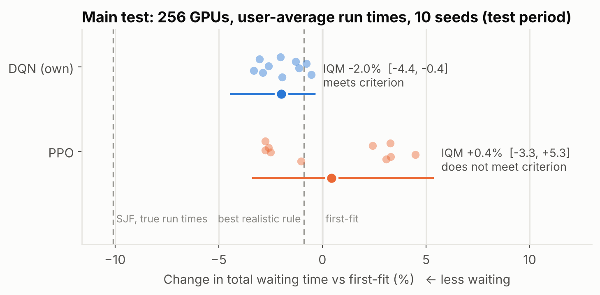

# rl-gpu-scheduler

Reinforcement learning for deciding **which queued deep learning job starts next** on a
shared GPU cluster, evaluated by replaying Microsoft's
[Philly trace](https://github.com/msr-fiddle/philly-traces).

The repository contains a trace-driven cluster simulator with the Gymnasium API,
rule-based baseline schedulers, a DQN implementation with invalid-action masking,
MaskablePPO agents, run-time predictors, and a pre-registered evaluation of all of
them on held-out data.

## Research questions

* **RQ1.** Can an RL agent that does not know true job run times wait less than first-fit?
* **RQ2.** How much does its performance depend on run-time information (none, user
  average, a learned predictor, true run times)?
* **RQ3.** Do the conclusions hold on a different virtual cluster?

## Key results

All numbers are on the **test period** (last 30% of jobs by submit time), which was not
used for training, tuning or checkpoint selection. The test plan was fixed in
[`PREREGISTRATION.md`](PREREGISTRATION.md) before any trained agent was evaluated on it.
Values are the change in total waiting time vs FIFO first-fit (negative = less waiting),
interquartile mean (IQM) over seeds with a 95% bootstrap CI that resamples seeds and
episodes.

**Main test** — virtual cluster `6214e9`, 256 GPUs, user-average run times, 10 seeds,
15 non-overlapping 1,024-job episodes:

| Policy | Change in total wait | Success criterion (CI < 0) |
|---|---|---|
| DQN (per-job scorer, no WAIT action) | **-2.0% [-4.4, -0.4]**; every seed between -0.5% and -3.3% | met |
| MaskablePPO (per-job scorer) | +0.4% [-3.3, +5.3]; 5 seeds better, 5 worse | not met |
| Best realistic rule (SJF with predicted run times) | -0.9% | |
| SJF with true run times (reference, not achievable) | -10.1% | |

* **Small and not robust.** DQN is about 1 point better than the best realistic rule. On
  30 randomly placed (overlapping) episodes the gain disappears: DQN +2.5% [-11.9, +22.1],
  PPO +12.2% [-1.9, +35.4], while smallest-GPU-first reaches -5.4%.
* **No deliberate waiting.** PPO chose WAIT in 0% of decisions in every setting; DQN is
  trained without the WAIT action (with it, DQN stalled on validation).

**Scarcer clusters** (user-average run times, 5 seeds):

| GPUs | DQN | PPO | Best realistic rule | SJF (true) |
|---|---|---|---|---|
| 128 | **-7.4% [-12.4, -3.3]** (met) | -0.2% [-5.1, +3.3] | -6.4% (SJF, predicted) | -23.5% |
| 192 | -4.5% [-9.6, +0.8] | +1.5% [-3.4, +9.4] | -6.2% (smallest-GPU-first) | -11.4% |

**Busier vs lighter test episodes** (exploratory; the same 15 episodes split at the median
offered load; [`results/analysis/load/`](results/analysis/load/)):

| Policy | 256 GPUs: lighter / busier half | 128 GPUs: lighter / busier half |
|---|---|---|
| DQN | -1.9% / -2.7% | -5.4% / -8.6% |
| PPO | +0.2% / +0.6% | -1.9% / +0.9% |
| SJF (predicted) | -0.4% / -1.7% | -2.5% / -9.1% |
| SJF (true run times) | -7.3% / -15.2% | -20.2% / -25.7% |

Busier episodes hold about twice the possible gain at 256 GPUs, but DQN's advantage
barely grows; at 128 GPUs simple SJF rules gain as much as DQN in the busier half.

**Value of run-time information** (PPO, 5 seeds; share of the first-fit to SJF(true) gap
closed):

| Information given to the agent | 256 GPUs | 128 GPUs |
|---|---|---|
| True run times | 68% (-10.3% [-15.7, +3.0]) | 73% (-22.9% [-32.0, -2.2]) |
| Predicted (boosted-tree model) | 2% | 9% |
| User's past average | -5% | 5% |
| None | -7% | 0% |

With true run times, 4 of 5 PPO seeds match SJF with true run times (one seed fails to
learn at both sizes). With any realistic information, PPO does not beat the best simple rule.

**Run-time signals as direct agent inputs** (E1b, pre-registered addendum): the
user-average agents given 8 more inputs per job (the user's job count, median, spread,
last-2 and same-GPU-count run times, failure share, time of day);
[`results/rl/C_signals_vs_estimate/`](results/rl/C_signals_vs_estimate/):

| Agents | With signals | User average only | Difference, points [95% CI] |
|---|---|---|---|
| DQN, 256 GPUs (10 seeds) | -0.2% [-4.0, +4.0] | -2.0% [-4.4, -0.4] | +1.8 [-0.5, +5.4] |
| PPO, 256 GPUs (10 seeds) | -0.8% [-3.5, +2.0] | +0.4% [-3.3, +5.3] | -1.2 [-5.7, +2.9] |
| DQN, 128 GPUs (5 seeds) | -8.2% [-14.2, -1.7] | -7.4% [-12.4, -3.3] | -0.8 [-7.1, +5.8] |
| PPO, 128 GPUs (5 seeds) | -4.1% [-11.7, +1.3] | -0.2% [-5.1, +3.3] | -3.9 [-11.6, +3.0] |

No difference is significant, as stated in advance: the same signals order nearby test
jobs barely better than a coin flip. With the extra inputs, DQN at 256 GPUs no longer meets
the success criterion.

**Another virtual cluster** (`11cb48`, 72 GPUs = same offered load as the main test;
agents from the main test, no retraining):

| | 5 non-overlapping episodes | 30 overlapping episodes |
|---|---|---|
| DQN | -1.0% [-17.9, +15.7] (not met) | -2.8% [-6.1, +1.7]; every seed between -2.2% and -3.8% |
| PPO | +1.4% [-10.3, +12.8] (not met) | -1.0% [-4.4, +2.6] |
| Best realistic rule | -1.5% (random) | -2.5% (SJF, user average) |
| SJF (true) | -5.9% | -9.6% |

**Other measures** ([`results/analysis/secondary/`](results/analysis/secondary/)): average,
median and P99 job completion time, bounded slowdown and GPU utilization follow the
waiting-time results. At 256 GPUs DQN cuts average completion time by 1.3% and bounded
slowdown by 3.9%; no policy moves P99 completion time by more than 3.3% or utilization by
more than 3 points.

**Takeaways.** Realistic run-time estimates order nearby jobs barely better than a coin
flip (52-54% on test), so neither rules nor agents recover much of the gain that true run
times would give. The RL edge, where it exists, is largest when GPUs are scarcest and is
of the same size as the best simple rule.

Figures: [`results/figures/`](results/figures/) (`main_test_256`, `information_levels`,
`scarcity`, `capability_check`; PNG and PDF).



## Installation

Python 3.10 or newer (tested with 3.13 and 3.14).

```bash
python -m venv .venv && source .venv/bin/activate
pip install -r requirements.txt        # simulator, baselines, predictors
pip install -r requirements-rl.txt     # DQN (PyTorch) and MaskablePPO (sb3-contrib)
python -m pytest -q                    # 36 tests
```

## Data

The Philly trace (about 1 GB compressed) is stored with Git LFS in
[msr-fiddle/philly-traces](https://github.com/msr-fiddle/philly-traces). Raw and processed
data are not committed (`data/` is git-ignored).

```bash
git lfs install
git clone https://github.com/msr-fiddle/philly-traces.git
tar -xzf philly-traces/trace-data.tar.gz -C philly-traces
python scripts/prepare_philly.py --job-log philly-traces/trace-data/cluster_job_log   # -> data/philly_jobs.csv
python scripts/build_predictions.py --vc 6214e9                                     # -> data/philly_jobs_pred_6214e9.csv
```

`prepare_philly.py` merges each job's retries into one job (run time = sum of attempts),
keeps killed and failed jobs (they used GPUs), and prints the workload statistics below.

## Reproducing the results

Every result folder under `results/` was produced by the commands below, except the original
single-seed checks in `results/validation/batch*.csv` (step 3 re-creates their settings). Training
runs write checkpoints to `runs/` (git-ignored).

```bash
# 1. Rule-based baselines (main setup and other cluster sizes)
python scripts/run_baselines.py --data philly --jobs-csv data/philly_jobs_pred_6214e9.csv --vc 6214e9 \
    --capacity 256 --warm-start --non-overlapping --out results/philly_6214e9_c256_warm_nonoverlap
python scripts/run_baselines.py --data philly --vc 6214e9 --capacity 256 --warm-start \
    --out results/philly_6214e9_c256_warm                                  # 30 overlapping episodes

# 2. Simulator vs recorded waits; offered load per period
python scripts/check_trace_waits.py --job-log philly-traces/trace-data/cluster_job_log

# 3. Capability checks (validation only; agents see true run times; 3 seeds per setting).
#    Each batch line sets every value that differs from today's frozen configs/, so it
#    re-creates the settings of the original single-seed checks in results/validation/.
python scripts/diagnose_architecture.py --capacity 256
for b in A_small A2_slot A3_dqn_dueling A4_dqn_wait A5_dqn_stable A6_dqn_wait_frozen; do
  python scripts/run_many.py batches/$b.txt --parallel 2
done
python scripts/summarize_capability.py --runs runs/capability --out results/validation/rerun

# 4. Main experiments: 70 training runs (about 1 h at --parallel 2 on a laptop CPU)
python scripts/run_many.py batches/B_main.txt --parallel 2

# 5. Test-period evaluation
python scripts/evaluate.py --runs runs/B/* --out results/rl/B_test
python scripts/evaluate.py --runs runs/B/ppo_c256_estimate runs/B/dqn_c256_estimate \
    --overlapping --out results/rl/B_test_overlapping_main
python scripts/evaluate.py --runs runs/B/dqn_c256_estimate runs/B/ppo_c256_estimate \
    --jobs-csv data/philly_jobs.csv --vc 11cb48 --capacity 72 --out results/rl/E3_11cb48
python scripts/evaluate.py --runs runs/B/dqn_c256_estimate runs/B/ppo_c256_estimate \
    --jobs-csv data/philly_jobs.csv --vc 11cb48 --capacity 72 --overlapping --out results/rl/E3_11cb48_overlapping

# 5b. E1b, run-time signals as direct agent inputs (pre-registered addendum)
python scripts/run_many.py batches/C_signals.txt --parallel 2
python scripts/evaluate.py --runs runs/C/* --out results/rl/C_test
python scripts/compare_settings.py --a results/rl/C_test --b results/rl/B_test \
    --a-info signals --b-info estimate --out results/rl/C_signals_vs_estimate

# 6. Exploratory analyses of the main test (no training needed)
python scripts/analyze_load.py --report results/rl/B_test --out results/analysis/load
python scripts/summarize_secondary.py --report results/rl/B_test --out results/analysis/secondary

# 7. Figures (from committed result files only)
python scripts/make_figures.py
```

Training uses the CPU; one run takes 1-2 minutes on a recent laptop.

## Environment

| Part | Definition |
|---|---|
| Simulator | Event-driven replay of one pool of `C` GPUs. Jobs arrive at their trace submit times, need all their GPUs at once (gang scheduling), and run for their trace duration. No preemption. |
| Decision point | Whenever at least one job in the visible window fits in the free GPUs. Time jumps between arrivals and completions. |
| State (52 values in [0, 1]) | For each of the first 10 queued jobs: slot filled, GPUs requested / C, fits now, log run-time feature, log time waited. Plus free GPUs / C and log queue length. Fixed scales, so inputs mean the same in 256- and 1,024-job episodes. |
| Run-time feature | `estimate`: user's past average (realistic). `predicted`: boosted-tree model on submit-time features (realistic). `oracle`: true run time (reference). `none`: 0. `signals`: user's past average plus 8 extra inputs per job (the user's job count, median, spread, last-2 and same-GPU-count run times, failure share, time of day), appended after the 2 global values (132 inputs in all). |
| Action (Discrete(11)) | 0-9: start the job in that queue slot. 10: WAIT until the next arrival or completion. Invalid actions are masked (`env.action_masks()`). |
| Reward | Minus the waiting time accrued by all queued jobs since the last step (scaled). Summed over an episode it equals minus the total waiting time, so maximizing return minimizes average job completion time. An episode-end bounded-slowdown reward (`bsld`) is also available. |
| Episodes | Consecutive jobs from the trace. Training: 256 jobs. Testing: 1,024 jobs. |
| Warm start | Each episode begins with the jobs that, per the trace, were still running at that moment. They hold GPUs but are excluded from the metrics. Without it, an empty start removes most of the real load. |
| Splits | By submit time: fit (first 70% minus its last 15%), validation (last 15% of the first 70%), test (last 30%). |

**Agents.** Both agents score every queued job with one shared network
(`gpusched/nets.py`, as in RLScheduler), so what is learned for one queue slot holds for
all. A plain MLP over all 52 inputs could not even imitate SJF (84% vs 99% agreement) and
did not learn. DQN (`gpusched/dqn.py`): Double DQN, target network, Huber loss, gradient
clipping, invalid actions masked in action choice and in targets. PPO: MaskablePPO from
sb3-contrib. Frozen hyperparameters and the evidence behind them: [`configs/`](configs/).

## Baselines

All baselines see the same 10-job window as the agents.

| Name | Rule |
|---|---|
| `random` | Random job among those that fit |
| `fifo` | Strict first-in-first-out: if the oldest job does not fit, wait |
| `fifo_ff` | First-fit: the oldest job that fits now (reference) |
| `sgf` | Smallest GPU request first |
| `sjf` | Shortest job first, user's past average |
| `sjf_pred` | Shortest job first, predicted run time |
| `sjf_oracle` | Shortest job first, true run time (not possible in practice) |

## Supporting results

**Workload** (`prepare_philly.py`): 111,798 usable jobs from 319 users in 15 virtual
clusters over 136.9 days. 25% finish within 1.9 min, median 20 min, 99th percentile 7.6
days, longest about 60 days. 86.6% use one GPU. The user's past average is off by a median
factor of about 3. In virtual cluster `6214e9` (51,955 jobs), jobs longer than 8 days use
62% of the GPU-time.

**Simulator vs trace** (`results/trace_check/`, same 15,360 test jobs):

| Source | Mean wait | Median wait | Waited > 1 h |
|---|---|---|---|
| Trace (recorded) | 1.45 h | 4 min | 10% |
| Simulator, first-fit, 256 GPUs | 7.0 h | 3.1 h | 65% |
| Simulator, first-fit, 128 GPUs | 28.7 h | 21.5 h | 86% |

`6214e9` really used up to 696 GPUs during the test period, so all studied sizes
(128-256 GPUs) are **GPU-scarcity scenarios**, not a replay of the real cluster. Offered
load at 256 GPUs: fit 1.02, validation 1.41, test 0.41.

**Rule-based baselines by cluster size** (15 non-overlapping test episodes, change vs first-fit):

| GPUs | SJF (true) | SJF (predicted) | SJF (user avg) | Smallest-GPU-first |
|---|---|---|---|---|
| 128 | -23.5% [-33.1, -13.1] | -6.4% [-10.6, -1.2] | -5.9% [-10.2, -1.0] | -6.1% [-8.3, -3.2] |
| 192 | -11.4% [-15.9, -7.7] | -3.2% [-6.1, -1.0] | -3.2% [-7.3, +2.1] | -6.2% [-13.3, -0.7] |
| 256 | -10.1% [-16.2, -4.2] | -0.9% [-2.7, +0.4] | +0.1% [-4.0, +6.2] | -0.9% [-2.5, +1.2] |
| 320 | -12.9% [-22.3, -4.2] | -1.9% [-4.6, +0.4] | -0.2% [-6.6, +8.1] | -1.2% [-3.6, +1.1] |
| 384 | -11.8% [-23.0, -3.2] | -2.1% [-6.5, +2.2] | -0.6% [-9.2, +10.4] | -3.1% [-8.2, +1.5] |
| 512 | -18.8% [-53.4, -3.3] | -10.0% [-33.9, +0.1] | -12.7% [-41.2, +0.1] | -11.7% [-39.4, +0.0] |

Strict FIFO is the worst rule (+16.8% at 256 GPUs). Overlapping episodes over-weight a few
busy periods (SJF with user averages: +18.2% there vs +0.1% on non-overlapping episodes),
so non-overlapping episodes are the main result.

**Run-time predictors** (`results/predictor/`; features known at submit time only: GPUs
requested, the user's finished jobs, hour and weekday, recent submissions):

| Predictor | Pair-order accuracy, validation | Pair-order accuracy, test | Median error factor, test |
|---|---|---|---|
| User average | 54.5% | 52.0% | x5.05 |
| User median | 54.2% | 52.9% | x2.56 |
| User's last 2 jobs | 55.5% | 54.0% | x2.58 |
| Boosted-tree model | 58.3% | 52.8% | x5.83 |

Pair-order accuracy is how often two nearby queued jobs are put in the right order (50% =
coin flip).

**Capability checks** (validation only, agents see true run times; `results/validation/`):

| Network / setting | Best validation result | SJF (true) |
|---|---|---|
| Flat MLP (PPO, DQN) | -0.4% to -3.7% | -20.4% |
| Per-job scorer, PPO, gamma 1.0 | -20.6% (256 GPUs), -19.2% (128 GPUs) | -20.4% / -17.6% |
| Per-job scorer, PPO, gamma 0.99 | -4.0% (256 GPUs) | -20.4% |
| Per-job scorer, DQN with WAIT | -10.3% (chooses WAIT 20-30% of the time) | -20.4% |
| Per-job scorer, DQN without WAIT | -18.7% early in training, then drifts to about -5% | -20.4% |

With a discount factor below 1, WAIT pushes later costs further away and looks cheaper
than it is, so agents learn to stall; PPO therefore uses gamma = 1. DQN is trained without
WAIT and evaluated at its best validation checkpoint.

## Modeling assumptions and limitations

* **One pool of GPUs.** No placement on specific servers and no locality; a machine-level
  model (for example 8-GPU servers) is not implemented.
* **Smaller than the real cluster.** All studied sizes are scarcity scenarios (see above).
* **Retries folded into one job**; killed and failed jobs are kept. No preemption.
* **Window of 10.** Neither agents nor baselines can start a job beyond the first 10 queued.
* **Warm start is an approximation.** Background jobs are assumed to have started at
  submission; those that do not fit are skipped (130-150 per episode at 256 GPUs), so
  load is underestimated.
* **Load differs by period.** The validation period is busier than the test period
  (offered load 1.41 vs 0.41 at 256 GPUs), so checkpoints are selected in a more crowded
  regime than the one they are tested in.
* **Few episodes on `11cb48`**: its test period holds only 5 non-overlapping episodes.
* Run-time estimates use the trace's real history (jobs finished before submission), not
  the simulator's finish times. Jobs needing more GPUs than the cluster has are dropped.

## Repository layout

```
gpusched/
  data.py          Philly parser, synthetic jobs, run-time estimates, splits, cluster sizing
  env.py           GPUSchedEnv (Gymnasium environment)
  baselines.py     Rule-based policies and run_episode()
  metrics.py       Episode metrics, IQM, bootstrap confidence intervals
  predict.py       Leak-free run-time features, simple predictors, boosted-tree model, agent signals
  dqn.py           DQN with invalid-action masking, optional n-step returns (PyTorch)
  nets.py          Per-job scorer, dueling variant, MaskablePPO policy
  experiment.py    Data splits, environments, loading agents
  stats.py         Success criterion (IQM over seeds, seed and episode bootstrap), gap closed, differences
scripts/
  prepare_philly.py       Parse cluster_job_log -> data/philly_jobs.csv
  build_predictions.py    Train and compare run-time predictors -> pred_duration per job
  check_env.py            Gymnasium API check and speed test
  run_baselines.py        Evaluate baselines; tables and figures
  check_trace_waits.py    Recorded vs simulated waits; GPUs in use; offered load
  diagnose_architecture.py  Can a network imitate SJF(true)? (flat MLP vs per-job scorer)
  train.py                Train DQN or MaskablePPO for one seed; best checkpoint on validation
  evaluate.py             Test-period evaluation and success criterion
  compare_settings.py     Same agents with two information levels: difference and its CI
  run_many.py             Run a batch file of training commands in parallel
  summarize_runs.py       One line per training run (validation results)
  summarize_capability.py Capability checks over seeds vs the original single-seed checks
  smoke_maskable_ppo.py   Quick check that MaskablePPO trains on the environment
  plot_paired_figure.py   Paired-comparison figure from a paired.csv
  make_figures.py         Summary figures -> results/figures/
  analyze_load.py         Exploratory: advantage in busier vs lighter test episodes
  summarize_secondary.py  Completion-time percentiles, slowdown and utilization per policy
configs/           Frozen hyperparameters (dqn.json, ppo.json) and the reasons for them
batches/           Training commands for each experiment batch
results/           Committed results (baselines, trace check, predictors, validation, RL tests, analyses, figures)
tests/             36 tests (simulator, rewards, warm start, statistics, predictors, DQN, networks, signals)
PREREGISTRATION.md Test plan fixed before any trained agent was evaluated on the test period
```

## Tests

```bash
python -m pytest -q
```

The tests check schedules and rewards computed by hand, warm start, paired statistics,
the trace parser, that predictor features never use future information, the success
criterion, masked action choice and Double-DQN targets, and that DQN learns a toy task
where holding a GPU free for a short job beats SJF with true run times.

## References

* M. Jeon et al., "Analysis of Large-Scale Multi-Tenant GPU Clusters for DNN Training Workloads," USENIX ATC 2019.
* Q. Hu et al., "Characterization and Prediction of Deep Learning Workloads in Large-Scale GPU Datacenters," SC 2021.
* H. Mao et al., "Resource Management with Deep Reinforcement Learning," HotNets 2016.
* H. Mao et al., "Learning Scheduling Algorithms for Data Processing Clusters," SIGCOMM 2019.
* D. Zhang et al., "RLScheduler: An Automated HPC Batch Job Scheduler Using Reinforcement Learning," SC 2020.
* S. Dongare et al., "Hybrid Learning and Optimization-Based Dynamic Scheduling for DL Workloads on Heterogeneous GPU Clusters," arXiv:2512.10271, 2025.
* V. Mnih et al., "Human-Level Control through Deep Reinforcement Learning," Nature 2015.
* H. van Hasselt et al., "Deep Reinforcement Learning with Double Q-Learning," AAAI 2016.
* J. Schulman et al., "Proximal Policy Optimization Algorithms," arXiv:1707.06347, 2017.
* S. Huang and S. Ontañón, "A Closer Look at Invalid Action Masking in Policy Gradient Algorithms," FLAIRS 2022.
* R. Agarwal et al., "Deep Reinforcement Learning at the Edge of the Statistical Precipice," NeurIPS 2021.
